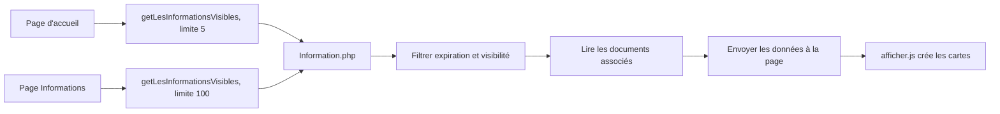
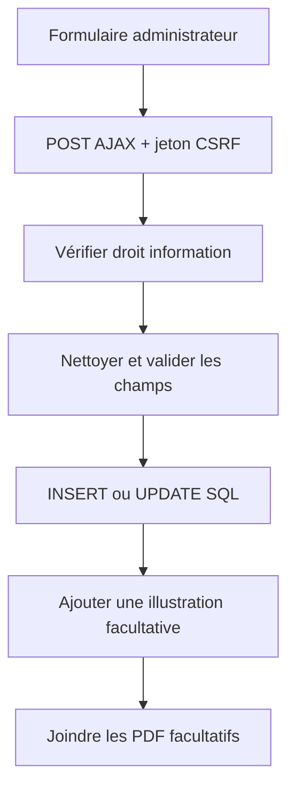

---
tags:
  - module/informations
  - architecture
---

# Architecture du module

## Couches et responsabilités

Le module sépare les pages, les règles métier, la persistance SQL et les fichiers :

| Couche | Rôle | Fichiers principaux |
|---|---|---|
| Pages publiques | Charger les données selon le visiteur et construire la page | [`public/index.php`](../../public/index.php), [`public/information/index.php`](../../public/information/index.php) |
| Présentation | Transformer les objets d’information en éléments HTML et les mettre en forme | [`public/information/afficher.js`](../../public/information/afficher.js), [`public/information/index.css`](../../public/information/index.css) |
| Administration | Afficher le formulaire, envoyer les actions AJAX et gérer les pièces jointes | [`public/administration/information/`](../../public/administration/information/) |
| Métier et données | Contrôler les valeurs, appliquer la visibilité, écrire et lire en base | [`src/ClasseMetier/Information.php`](../../src/ClasseMetier/Information.php) |
| Stockage | Conserver les illustrations, images du texte et PDF séparément de leurs métadonnées | `public/data/photoinformation/`, `public/data/informationcontenu/`, `public/data/documentinformation/` |
| Schéma SQL | Définir les informations, documents et contraintes relationnelles | [`sql/information/create.sql`](../../sql/information/create.sql) |

`Information` est le point commun des pages publiques et administratives : il évite de dupliquer les règles de visibilité et les opérations SQL dans les contrôleurs.

## Parcours de consultation

Le contrôleur de la page transmet les données via `Page::setDonnee`. Le mécanisme de page sérialise ces données dans le HTML, puis `getData` les relit côté navigateur. Le JavaScript de rendu est commun à l’accueil, à l’espace membre et à l’archive publique.

## Parcours de publication

La création ou la modification de l’information est une opération distincte de l’ajout de PDF. L’interface enregistre l’information, puis ouvre son écran de documents. L’illustration principale est stockée dans la bibliothèque ; les images téléversées depuis l’éditeur de texte sont stockées dans un dossier distinct, sauf si l’option d’ajout à la bibliothèque est cochée.

## Accès aux documents

Les liens PDF ne pointent pas directement vers le répertoire de stockage. Ils passent par `public/information/afficherdocumentinformation.php`, qui demande au modèle si le document appartient à une information actuellement visible, puis lit et renvoie le fichier.

## Conventions de mise à jour

- Pour ajouter ou modifier les tables, consulter les scripts sous [`sql/information/`](../../sql/information/).
- Le droit `information` est créé/attribué par [`sql/information/permission.sql`](../../sql/information/permission.sql) lors d’une migration prévue pour la base existante.
- Les configurations des fichiers sont dans [`config/documentinformation.php`](../../config/documentinformation.php) et [`config/image.php`](../../config/image.php).
